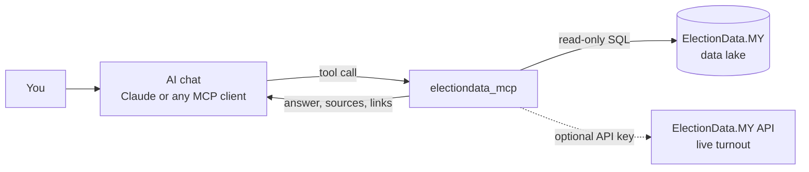

# electiondata_mcp

An MCP server for Malaysian election data from [ElectionData.MY](https://electiondata.my/).

It lets an AI chat answer questions about every federal and state election since 1955:
seat histories, full contest results, candidates, parties, by-elections, polling-centre
results, voter demographics, boundary maps, and live turnout on polling day. It can also
run its own read-only SQL over all 208 datasets in the ElectionData.MY data lake.

Every answer lists its sources (dataset, file link, data-as-of date) and the matching
electiondata.my dashboard page, so a person can check a number before using it.

<p align="center">
  
</p>

## What you can ask

The answers are real results from the tools; the polling-day row describes what the tool
gives. Ask in plain words; the chat picks the tools.

| Who | Question | Tools | Answer |
|---|---|---|---|
| News desk | Who won Lembah Pantai in GE-15, and by how much? | `contest_result` | Ahmad Fahmi bin Mohamed Fadzil (PKR, PH), 35,359 votes, majority 13,912 |
| Election night | Which GE-15 seats were the closest? | `marginal_seats` | P.203 Lubok Antu by 100 votes, P.173 Putatan by 124, P.032 Gua Musang by 163 |
| Analyst | How did BN's vote share change in Kelantan from GE-14 to GE-15? | `swing` | Down 12.48 points on average per seat, over 14 seats |
| Profile writer | What is Anwar Ibrahim's election record? | `search`, `candidate_profile` | 8 contests, 8 wins: Permatang Pauh (1982 to 2013, UMNO then PKR), Port Dickson by-election 2018, Tambun 2022 |
| Campaign team | Who votes in Lembah Pantai? | `seat_demographics` | 101,828 voters on the GE-15 roll: 53,094 men and 48,734 women, with age bands, ethnicity and voter type |
| Voter | I'm at KLCC. Which Parliament seat is that? | `find_seat_by_location` | P.120 Bukit Bintang |
| Latest results | How did the 2026 Melaka state election end? | `election_summary` | BN 21, PH 4, PN 3 of 28 seats; turnout 71.77% |
| Data scientist | Give me one row per GE-15 seat to build a model | `seat_features`, `data_access` | Turnout, majority, winner, vote share per coalition, previous result and voter mix per seat, plus Parquet links and code to load everything |
| Polling day | What is the turnout now? | `live_turnout` (API key) | Provisional turnout from the SPR feed, every 5 minutes from 08:00 to 18:00 MYT |

## How it works



The server runs on your machine or your own server. It reads the public data lake directly,
checks each SQL query from the chat before it runs, and returns each number with its source.

## Supported platforms

| OS | ARM | x86 |
|---|---|---|
| macOS | yes | yes |
| Windows | yes | yes |
| Linux | yes | yes |

Python 3.12 to 3.14. Every dependency installs from a ready-made build, so no compiler is
needed. CI runs the tests and the installers on all six platforms.

## Requirements

- An internet connection. The server reads the public data lake at `lake.electiondata.my`.
- Nothing else for the one-command install: it installs [uv](https://docs.astral.sh/uv/),
  which brings its own Python.
- Optional: a free ElectionData.MY API key for three tools (`live_turnout`, `seat_lineage`,
  `party_history`). Get one at https://electiondata.my/console/. All other tools work without it.

## Install

One command per platform. Each one installs uv if it is missing, installs the
`electiondata-mcp` command, runs a self-check, and prints how to connect it.

macOS and Linux:

```sh
curl -LsSf https://raw.githubusercontent.com/azwanzuharimi/electiondata_mcp/main/install.sh | sh
```

Windows (PowerShell):

```powershell
powershell -ExecutionPolicy ByPass -c "irm https://raw.githubusercontent.com/azwanzuharimi/electiondata_mcp/main/install.ps1 | iex"
```

Docker (any OS, `linux/amd64` and `linux/arm64`):

```sh
docker run -p 8000:8000 ghcr.io/azwanzuharimi/electiondata_mcp
```

Check an install at any time:

```sh
electiondata-mcp --check
```

## Connect

**Claude Code:**

```sh
claude mcp add electiondata -- electiondata-mcp
```

With an API key:

```sh
claude mcp add electiondata -e ELECTIONDATA_API_KEY=your-key -- electiondata-mcp
```

**Claude Desktop:** add this to `claude_desktop_config.json` and restart Claude Desktop. Use
the full path that the installer printed if `electiondata-mcp` is not found.

```json
{
  "mcpServers": {
    "electiondata": {
      "command": "electiondata-mcp",
      "env": { "ELECTIONDATA_API_KEY": "your-key" }
    }
  }
}
```

**Web chat apps and claude.ai:** run the server over HTTP, put it behind HTTPS on a public
address, and add `https://your-host/mcp` as a custom connector.

```sh
electiondata-mcp --http --host 0.0.0.0 --port 8000
```

Any MCP client that speaks Streamable HTTP can use `http://your-host:8000/mcp`. `GET /health`
returns `{"ok": true}`.

## Settings

| Environment variable | Default | Meaning |
|---|---|---|
| `ELECTIONDATA_API_KEY` | not set | Key for the API tools. Never logged or returned. |
| `RATE_LIMIT_PER_MIN` | `60` | HTTP requests per minute per client IP. `0` turns it off. |
| `DUCKDB_MEMORY_LIMIT` | `1GB` | Memory limit for queries. |
| `QUERY_TIMEOUT_S` | `30` | Time limit per query, in seconds. |
| `TRUST_PROXY` | not set | Set to `1` behind your own reverse proxy. The rate limit then uses the last `X-Forwarded-For` value. Leave unset when clients connect directly, or they can change their own IP. |

**Public servers:** also set a memory limit on the container, for example
`docker run --memory 2g --restart unless-stopped -p 8000:8000 ghcr.io/azwanzuharimi/electiondata_mcp`.
`run_sql` blocks the known ways to build huge values, but a container limit is the last guard.

## Tools

| Group | Tools |
|---|---|
| Find | `search` (seats, candidates, parties from loose text) |
| Look up | `seat_history`, `contest_result`, `candidate_profile`, `election_summary`, `byelections`, `seat_demographics`, `polling_centre_results`, `find_seat_by_location` |
| Analyse | `swing`, `marginal_seats`, `compare`, `seat_features`, `run_sql` |
| Discover | `search_datasets`, `describe_dataset`, `join_guide`, `find_dashboard`, `data_access` |
| API (key needed) | `live_turnout`, `seat_lineage`, `party_history` |

Resource `electiondata://guide` explains names, definitions, joins, traps and worked SQL.

`byelections` returns only by-elections. A full state election is not a by-election: it has its
own label (for example `SE-16` for the 2026 Johor, Negeri Sembilan and Melaka elections). Use
`election_summary` with that label and the state.

## Accuracy

- A seat or name that matches more than one thing returns the choices, not a guess. A match on
  part of a name says so in a `warning`.
- `run_sql` can read only the data lake. Other files, other websites, writes, setting changes,
  table functions and functions that build huge values (`range`, `repeat`, `lpad`, ...) are
  blocked. Results stop at 2,000 rows or 5 MB, and say so with `truncated`.
- A daily check runs on the live lake: one winner per contest, majority = winner minus runner-up,
  valid votes = sum of candidate votes, shares add up to 100%, turnout and majority formulas,
  and polling-centre totals = seat totals for every polling-centre file. GE-15 seat counts are
  checked against the published result.
- Live turnout is marked provisional and carries the SPR snapshot time in MYT.
- GE-15 was checked against the 16 SPR result gazettes (P.U. (B) 605 to 620 of 2022), all 222
  seats. 220 seats match on every field. P.104 Subang differs only in ballots issued, where the
  gazette misprints its own sum and the lake has the correct figure. P.028 Pasir Puteh differs in
  the lake, so national BN votes are 144 below the gazette. Tools flag this seat in
  `data_warnings`, and the guide lists it under "Known data issues".
- Bad input (an unknown seat or election, a wrong date format, a limit out of range) returns an
  error with a plain message. An unknown election lists the elections that exist.

## Development

```sh
git clone https://github.com/azwanzuharimi/electiondata_mcp
cd electiondata_mcp
uv sync
uv run pytest              # offline tests
uv run pytest -m live      # tests against the live lake (and the API if ELECTIONDATA_API_KEY is set)
uv run python scripts/build_catalogue.py   # refresh the dataset list and dashboard index
```

## Contributing

Other people cannot push to this repository. To change it:

1. Fork the repository and make a branch.
2. Add or change a test, then run `uv run pytest` and `uv run pytest -m live`.
3. Open a pull request. CI runs the tests on macOS, Linux and Windows (x86 and ARM).
   CI on a pull request has read-only access and no secrets.
4. The owner reviews and merges.

To report a wrong number, open an issue. Give the election, the seat, the tool call, the
number you got, and the official source (an SPR gazette if you can). A fault in the data itself
also goes to [ElectionData.MY](https://electiondata.my/).

## Data credit

All election data comes from [ElectionData.MY](https://electiondata.my/), the public face of
the Malaysian Election Corpus (MECo), curated by Thevesh Thevananthan. The data is dedicated to
the public domain under [CC0 1.0](https://creativecommons.org/publicdomain/zero/1.0/).
Please credit them when you use this server.

Cite the corpus as:

> Thevesh Thevananthan. *The Malaysian Election Corpus (MECo): Federal and State-Level Election
> Results from 1955 to 2025.* Scientific Data (2025).
> [doi:10.1038/s41597-025-06502-7](https://doi.org/10.1038/s41597-025-06502-7)

The official source of all Malaysian election results is the
[Election Commission of Malaysia (SPR)](https://spr.gov.my).

This project is not affiliated with ElectionData.MY or SPR.

## License

The code is under the [MIT License](LICENSE). The data keeps its own CC0 dedication.
